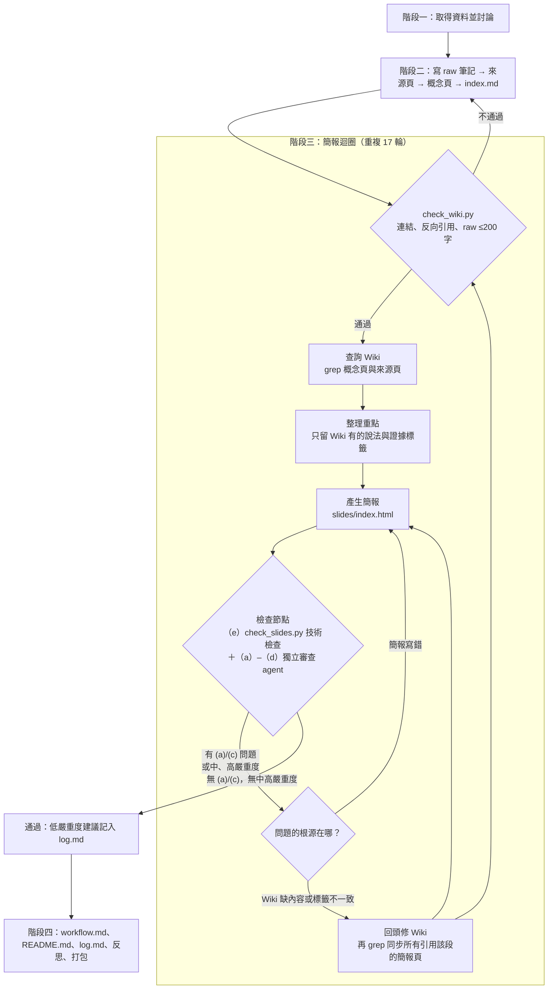

# workflow.md ── 這個專案的工作流程

## 1. 流程圖

## 2. 哪些步驟會重複

- **會重複**：「產生簡報 → 檢查」每一輪都重做，共 17 輪（v1 → v18）。每一輪的審查者都是**新開的**，沒有看過前面的對話、log.md 或之前的審查報告，避免「看習慣了就放過」。
- **偶爾重複**：「查詢 Wiki → 整理重點」只有在審查發現 Wiki 本身缺內容（例如第 1 輪：很多新手需要的解釋 Wiki 裡沒有）時才重做。
- **不重複**：階段一（取得資料）；階段二的 ingest 只做一次，之後只因審查結果而修補個別頁面。

## 3. 檢查與重做發生在哪裡

| 位置 | 檢查什麼 | 誰檢查 | 不通過時 |
|---|---|---|---|
| 階段二結束 | Wiki 連結有效、概念頁列出來源頁、來源頁反向列出概念頁、raw 筆記 ≤200 字 | `check_wiki.py`（自寫腳本） | 修 Wiki 重跑 |
| 階段三，每輪「產生簡報」之後 | (e) HTML 標籤配對、無外部依賴、頁底出處檔案存在、JS 語法、桌面與手機視窗無溢出、無 console 錯誤 | `check_slides.py`（Playwright＋Chrome） | 修簡報重跑 |
| 階段三，每輪「產生簡報」之後 | (a) Wiki 沒有的內容 (b) 出處對不上 (c) 證據類型誤用 (d) 新手看不懂；特別檢查 z 與潛在表示沒混 | 獨立審查 agent（每輪新開） | 見下 |
| 階段三，每輪 | 修正是否影響其他規則 | 審查者被要求「每個建議都檢查是否違反其他規則」 | 避免來回打架 |

**重做的範圍取決於問題的根源**：
1. 簡報自己寫錯 → 只重做「產生簡報」。
2. Wiki 缺內容或標籤不一致 → 先修 Wiki，跑 `check_wiki.py`，再用 grep 找出所有引用該段的簡報頁一起修。
3. 簡報自訂的規則（例如第 2 頁的徽章範圍規則）和實際做法不一致 → 改規則，並檢查所有頁面。

**通過標準**：沒有 (a)（Wiki 沒有的內容）和 (c)（證據類型誤用），而且沒有中、高嚴重度問題。只剩低嚴重度的 (b)(d)(e) 視為「通過並附建議」，建議記進 log.md。

## 4. 為什麼這樣設計

- **為什麼簡報只能用 Wiki**：這樣每一句話都能追到來源頁，審查才有客觀基準（拿簡報去對 Wiki，不靠審查者的記憶）。
- **為什麼檢查節點要獨立**：自己做的東西自己檢查，容易看不出自己的盲點。實際上，第 4 輪我為了回應審查意見自己補徽章，第 5 輪的審查者就指出矛盾，這正是需要獨立檢查的例子。
- **為什麼把 (e) 交給腳本、(a)–(d) 交給審查 agent**：HTML 能不能開、有沒有溢出，機器量測比人讀可靠；內容對不對需要讀懂，才交給審查 agent。
- **為什麼出問題要回頭查根源**：第 2–5 輪反覆出徽章問題，原因其實是 Wiki 的標籤不完整、簡報第 2 頁的規則做不到（第 6 輪才找到）。只修簡報表面會一直來回。
- **為什麼改了 Wiki 要 grep 同步簡報**：第 11 輪改了 Wiki 卻沒同步簡報，第 12 輪才被抓到，之後就加了這條固定步驟。
- **為什麼 log.md 記每一輪（含 v1 的問題）**：反思與流程調整只能根據真實紀錄，不能只留最終通過的版本。
- **工具與審查報告不放進 repo**：`check_wiki.py`、`check_slides.py`、審查報告與各版備份放在 repo 外，repo 只留成果；每輪的問題與修正摘要都在 log.md。
